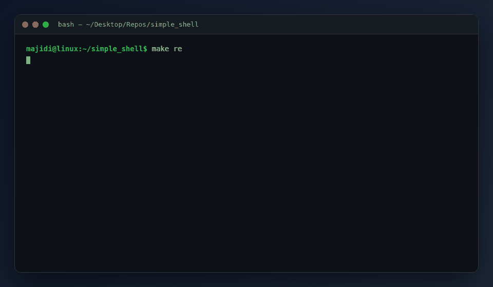
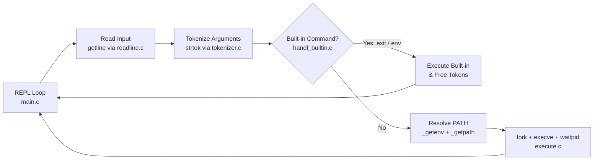
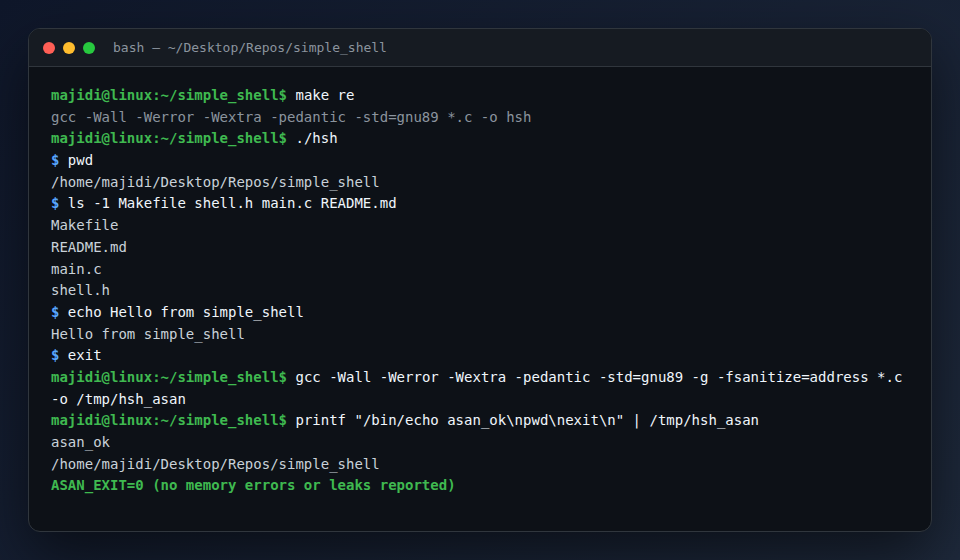

# Simple Shell (`hsh`)

-A8B9CC?logo=c&logoColor=white)


A custom UNIX command-line interpreter (`hsh`) implemented in **C** as an ALX Systems Programming capstone project. Supports interactive TTY and non-interactive piped execution, `PATH` command resolution, child process management (`fork`, `execve`, `waitpid`), and built-in commands (`exit`, `env`).

> **Project Status:** Completed (ALX Systems Programming Milestone). Built cleanly under strict GCC flags (`-Wall -Werror -Wextra -pedantic -std=gnu89`) with `Makefile` automation and GitHub Actions CI + Valgrind leak checking.

---

## Live Terminal Demo



---

## Execution Flow Architecture



---

## Features

- **Interactive & Non-Interactive Modes:** Prints `$ ` when attached to a TTY (`isatty(STDIN_FILENO)`) and handles EOF (`Ctrl+D`) or piped commands cleanly.
- **PATH Lookup (`getpath.c`, `getenv.c`):** Resolves bare command names (e.g., `ls`, `pwd`) using `PATH` and `stat()`, while also accepting direct executable paths (`/bin/ls`).
- **Process Creation (`execute.c`):** Spawns child processes via `fork()`, runs commands with `execve(..., environ)`, waits with `waitpid()`, and returns exit status `WEXITSTATUS(status)` (`127` when command not found).
- **Built-in Commands (`handl_builtin.c`):** Implements `exit [status]` (with numeric validation and error reporting) and `env`.
- **Custom String & Memory Helpers:** Custom `_strlen`, `_strcmp`, `_strcat`, `_strdup`, `_strcpy`, `_itoa`, `_atoi`, and token array cleanup (`freecmd.c`).

---

## Build & Usage

### Prerequisites
- Linux / POSIX environment
- `gcc` (GNU C89 compatible) and `make`

### Compilation

```bash
git clone https://github.com/Majidied/simple_shell.git
cd simple_shell
make
```

Or compile directly with the strict ALX flags:

```bash
gcc -Wall -Werror -Wextra -pedantic -std=gnu89 *.c -o hsh
```

### Interactive Mode

```bash
$ ./hsh
$ pwd
/home/majidi/Desktop/Repos/simple_shell
$ ls -1 Makefile shell.h main.c README.md
Makefile
README.md
main.c
shell.h
$ exit
```

### Non-Interactive Mode

```bash
printf "/bin/echo hello_simple_shell\npwd\nexit\n" | ./hsh
```

### Memory Check (AddressSanitizer & Valgrind)



Automated CI in [`.github/workflows/ci.yml`](.github/workflows/ci.yml) compiles `hsh`, verifies `make re`, runs a non-interactive smoke test, and checks memory safety with `valgrind --leak-check=full --error-exitcode=1 ./hsh`.

---

## File Structure

| File | Responsibility |
| :--- | :--- |
| [`main.c`](main.c) | Entry point, infinite REPL loop, command dispatch |
| [`shell.h`](shell.h) | Shared headers, `DELIM` macro, `environ`, function prototypes |
| [`readline.c`](readline.c) | TTY `$ ` prompt and `getline()` input capture |
| [`tokenizer.c`](tokenizer.c) | Whitespace splitting into heap-allocated `char **` array |
| [`execute.c`](execute.c) | `fork()`, `execve()`, `waitpid()`, and status propagation |
| [`getpath.c`](getpath.c), [`getenv.c`](getenv.c) | `environ` lookup and `PATH` executable resolution |
| [`handl_builtin.c`](handl_builtin.c) | Built-in detection (`is_builtin`) and `exit` / `env` handlers |
| [`freecmd.c`](freecmd.c) | Heap cleanup for tokenized command arrays |
| [`touls.c`](touls.c) | Error formatting (`print_error`), `_itoa`, `_atoi`, numeric checks |
| [`0-strcat.c`](0-strcat.c), [`2-strlen.c`](2-strlen.c), [`3-strcmp.c`](3-strcmp.c), [`3-strdup.c`](3-strdup.c), [`9-strcpy.c`](9-strcpy.c) | Custom C string helper implementations |
| [`Makefile`](Makefile) | `all`, `clean`, `fclean`, and `re` build targets |

---

## License

This project is licensed under the [MIT License](LICENSE).
